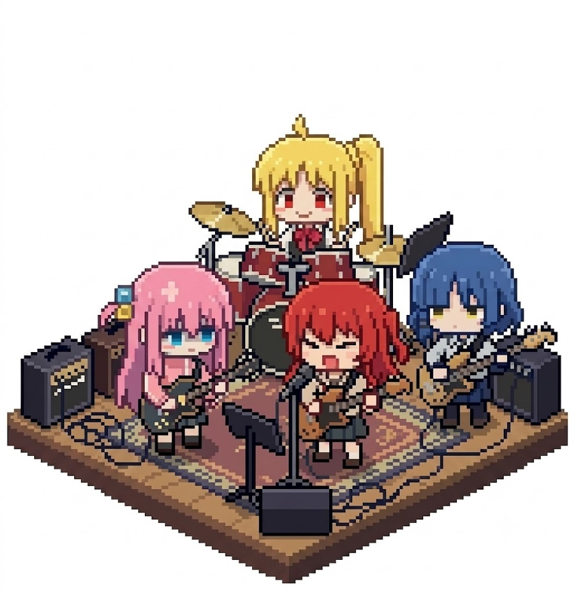
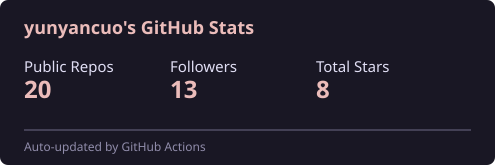
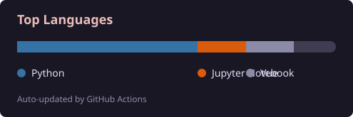
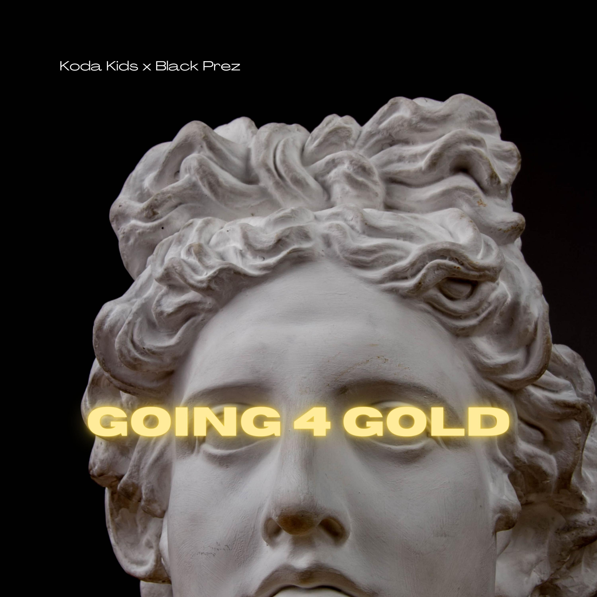

## 🌟 About Me

<h1>🎸 Hello, I'm 云烟错</h1>

<table>
<tr>
<td width="62%" valign="bottom">

<table align="center">
<tr><td>🎈 <strong>Personality</strong></td><td>Energetic, warm, and always up for new friends</td></tr>
<tr><td>🎧 <strong>Daily</strong></td><td>Coding / Music / Exploring AI</td></tr>
<tr><td>🛠️ <strong>Status</strong></td><td>Turning every bug into the next understanding</td></tr>
<tr><td>🎯 <strong>Goal</strong></td><td>Building useful, fun things worth leaving behind</td></tr>
</table>

</td>
<td width="38%" valign="bottom" align="right">

</td>
</tr>
</table>

---

## 🎀 Projects

<!-- PROJECTS:START -->
<table>
<tr>
<td width="50%" valign="top">

**🖥️ [todotree](https://github.com/Infinite-Monkey-Lab/todotree)**  
A Windows desktop todo wall — dark-gold, semi-transparent, truly pinned to the desktop layer (WorkerW). Data is just one Markdown file 
`Electron` `Markdown` `WorkerW` `Infinite Monkey Lab`

</td>
<td width="50%" valign="top">

**🏆 [astrbot_plugin_zhiren_leaderboard](https://github.com/yunyancuo/astrbot_plugin_zhiren_leaderboard)** 
Group-chat leaderboard plugin for AstrBot — score tracking, weekly auto-broadcasts and a built-in web ranking page 
`Python` `AstrBot Plugin` `Web UI`

</td>
</tr>
<tr>
<td width="50%" valign="top">

**🐋 [FeiyuCursor](https://github.com/Infinite-Monkey-Lab/FeiyuCursor)** 
DeepSeek-chan (大肥鱼) animated mouse cursor pack for Windows 11 — 16-frame breathing star-trail &amp; full 17-role coverage 
`Windows 11` `Cursor Pack` `DeepSeek` `Infinite Monkey Lab`

</td>
<td width="50%" valign="top">

**🚀 [velorag](https://github.com/yunyancuo/velorag)** 
Production-grade RAG framework — hybrid search + knowledge graph + agent canvas 
`Python` `RAG` `Knowledge Graph`

</td>
</tr>
<tr>
<td width="50%" valign="top">

**🐍 [astrbot_plugin_wuwa_echo](https://github.com/yunyancuo/astrbot_plugin_wuwa_echo)** 
Wuthering Waves echo scoring plugin for AstrBot 
`Python` `AstrBot Plugin`

</td>
<td width="50%" valign="top">

**🧪 [keresearch](https://github.com/Infinite-Monkey-Lab/keresearch)** 
Research-lifecycle Agent Skills: topic selection → experiments → writing → submission (Claude Code &amp; ZCode ready) 
`Agent Skills` `Claude Code` `ZCode` `Infinite Monkey Lab`

</td>
</tr>
<tr>
<td width="50%" valign="top">

**📚 [notes-for-deep-learniung](https://github.com/yunyancuo/notes-for-deep-learniung)** 
Deep learning paper notes with hands-on code 
`Jupyter` `Deep Learning`

</td>
<td width="50%" valign="top">

**🛠️ [campus-tls-fix](https://github.com/yunyancuo/campus-tls-fix)** 
Zero-dependency Windows .NET utility to fix campus TLS/SNI blocks for UU Remote timeouts and QQ/WeChat image loading 
`PowerShell` `.NET` `Networking`

</td>
</tr>
</table>

> Auto-updated · 2026-11-27 07:33 UTC
<!-- PROJECTS:END -->

---

## 🌈 Tech Stack

**Languages & Tools** 

 

**AI Focus** 

---

## 📊 GitHub Stats

<picture>
  <source media="(prefers-color-scheme: dark)" srcset="https://github.com/yunyancuo/yunyancuo/raw/main/assets/github-snake-dark.svg?v=2" />
  
</picture>

---

## 🎶 Today's BGM

*♪ Music on, ideas flow ♪*

<!-- NETEASE_BGM:START -->
  🎵 <strong>Going 4 Gold</strong> 🎼 Koda Kids、Black Prez <a href="https://music.163.com/#/song?id=2146946943">▶ Play on NetEase Music</a>
<!-- NETEASE_BGM:END -->

---

*「有目的的人才会迷路，我只是来人间散步。」*

**If you like my projects, a Star ⭐ is much appreciated**

